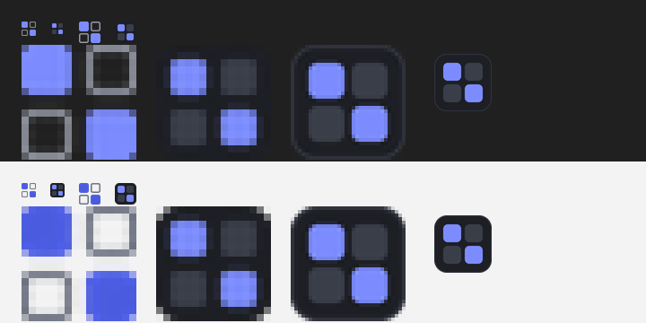

# Environments

Presets for Windows that close everything you don't need and launch what you do.
"Game" keeps Discord, Telegram, Steam and the game, closes the rest and starts Discord if it isn't running.

Status: active development, version 0.1.0. Platform: Windows desktop (WPF).
The application targets .NET 9; a framework-dependent build needs the .NET 9
Desktop Runtime. The isolated test harness uses the .NET 10 SDK.



## Features
- Built-in presets: Игра, Стрим / запись, Учёба / НМТ, Код, 3D / Blender, Чилл, Чистый лист (Ctrl+Alt+1…6, 0).
- Per preset: what to keep (apps or groups), what to launch if not running, close mode, hotkey, colour.
- Window layout: remember where the preset's apps sit right now (which monitor, half of the screen, maximized, minimized) and after every preset run each app's window returns to its spot — launched or already running.
- Close modes: gentle (WM_CLOSE only), smart (also kill apps that hid to the tray, never touch windows asking to save), force.
- "New desktop" presets: create a separate virtual desktop, switch to it and launch the preset's apps there, closing nothing.
- Preview before applying, "undo" relaunches whatever the last preset closed.
- Protected list: shell, system, drivers, overlays, terminals and Claude are never closed.
- Tray menu, global hotkeys, autostart, preset import/export.

## Build
Requires the .NET 9 SDK or newer. CI builds with the .NET 10 SDK.

```
dotnet publish src/Environments -c Release -r win-x64 --self-contained false -p:PublishSingleFile=true -o dist
```

Design assets (icons, tokens) live in `design/`. After changing an SVG there, run `node scripts/gen-icons.mjs` to regenerate `UI/IconData.cs`.

## Checks

```powershell
dotnet build src/Environments/Environments.csproj -c Release
dotnet run --project tests/Environments.Core.Tests -c Release
```

The test harness links the production matching, planner and snapshot code. It
supplies synthetic process trees and replaces native calls with a test boundary,
covering protected apps, kept descendants, helper processes, launch detection,
new desktops and cyclic ancestry. It never closes or launches real processes.
CI runs these checks on Windows for pushes and pull requests; interactive WPF,
hotkeys and real window placement still require a manual Windows session.

## Command line
```
Environments.exe --list
Environments.exe --dry-run "Игра"
Environments.exe --apply "Игра" [--limit notepad,mspaint]
Environments.exe --save-layout "Игра"   # remember the current window arrangement into the preset
Environments.exe --undo
Environments.exe --hidden        # start in the tray (used by autostart)
Environments.exe --preview game  # open the preview window for a preset right away
```
`--limit` restricts closing and launching to the named processes, which is handy for testing.

Demo mode for recordings: `ENVIRONMENTS_DEMO_CLOSE=mspaint,charmap` lets presets close only those processes, from the GUI, hotkeys and CLI alike.

Settings live in `%APPDATA%\Environments\config.json` (override with `ENVIRONMENTS_DATA`).
Design brief: [DESIGN.md](DESIGN.md).
